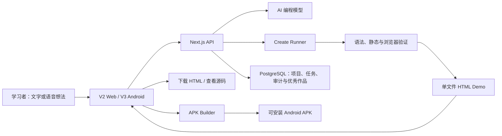

# AIYA 开源架构

## 主要边界

- **客户端**：采集用户意图、展示老师回应、试玩作品、管理本机项目。
- **Web API**：选择模型、记录任务、处理 TTS/搜索/更新清单、提供管理后台。
- **生成服务**：在独立工作区调用模型或编程 CLI，并输出结构化结果。
- **验证链路**：检查 HTML/CSS/JS 完整性、危险外链和关键交互。
- **APK 构建器**：把单文件作品装入受控 Android WebView 外壳。
- **数据层**：保存项目、版本、任务阶段、错误和优秀作品元数据。

## 为什么公开仓库没有 APK

APK 是可再生成的大型二进制文件，且正式包还涉及签名与发布策略。源码仓库只保存构建代码；测试或发布 APK 应使用 GitHub Releases、CI Artifact 或独立下载服务。
